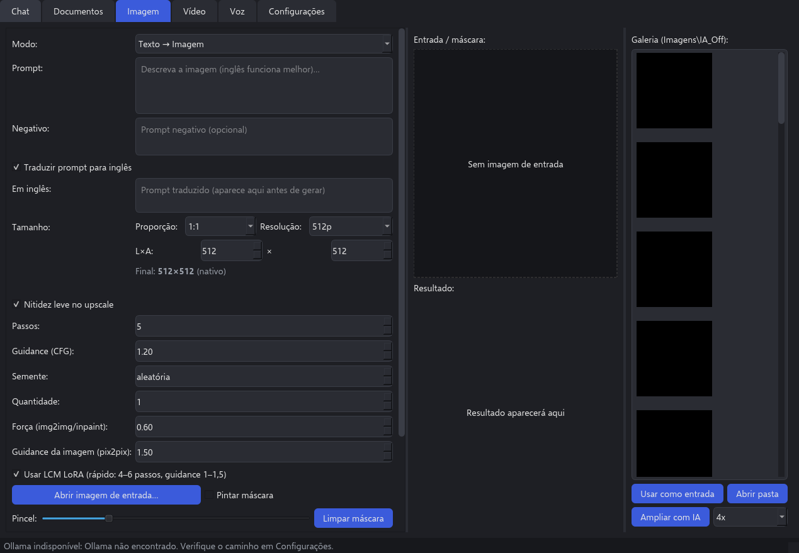

# Manual de uso – IA Off 3.0

App de IA 100% offline no seu PC: chat, perguntas sobre documentos, imagem, vídeo e voz, tudo rodando localmente. Depois de instalado, nada vai pra internet.

## 1. Abrir o app
- Dois cliques no atalho **IA Off** da Área de Trabalho.
- O app usa o **Ollama** pro chat e pros documentos. Se ele não estiver rodando, o app tenta iniciar sozinho. Se a barra de status mostrar "Ollama indisponível", confira o caminho em **Configurações**.
- As abas são: **Chat**, **Documentos**, **Imagem**, **Vídeo**, **Voz** e **Configurações**.

## 2. Chat
- Escolha o modelo no seletor do topo (ex.: `qwen3-30b-a3b`, o mais capaz; carrega em ~30 s na primeira mensagem e responde a uns 11 tokens por segundo). **Atualizar** recarrega a lista.
- Escreva e clique **Enviar** (ou Ctrl+Enter). **Parar** interrompe a resposta.
- **+ Nova conversa**, **Renomear** e **Excluir** ficam na barra lateral; as conversas ficam salvas.
- **Copiar última resposta** copia o texto da IA.
- A rolagem automática só acontece se você estiver no fim da conversa, então dá pra ler o começo enquanto a IA responde.
- **`qwen3.8-27b-aggressive`** (o modelo sem recusas): medido no seu PC, responde a **1,6 tokens por segundo** (umas 8x mais lento que o `qwen3-30b-a3b`) e leva uns 19 s pra carregar. Uma resposta de um parágrafo pode levar alguns minutos.
- **Importar GGUF…** cadastra no Ollama um modelo baixado em `.gguf`. Coloque o arquivo em `C:\IA\modelos\texto` antes.

## 3. Documentos
- **Adicionar arquivos…** aceita PDF, Word (DOCX), TXT e MD.
- Escreva a pergunta e clique **Perguntar**. A resposta cita o documento e o trecho de onde veio.
- **Remover selecionado** tira um documento; **Limpar base** apaga todos (não apaga seus arquivos originais).
- Usa o modelo de embeddings `embeddinggemma-2:740m` no Ollama. Se faltar, **Baixar modelo de embeddings** (precisa de internet uma única vez).
- O índice fica em `C:\IA\dados\rag`. Documentos importados na 2.x são trazidos automaticamente na primeira abertura.

## 4. Imagem

- **Modo**: Texto → Imagem, Imagem → Imagem, Inpaint (refazer uma parte) e Editar por instrução.
- **Prompt** e **Negativo**: pode escrever em português; com **Traduzir prompt para inglês** ligado, o texto traduzido aparece em "Em inglês" antes de gerar.
- **Tamanho**: escolha **Proporção** (1:1, 16:9, 9:16…) e **Resolução** (até 8K). O rótulo "Final" mostra o tamanho que vai sair. Acima do tamanho nativo do modelo, a imagem é ampliada no fim.
- **Passos**, **Guidance**, **Semente** e **Quantidade** ajustam a geração. Com **Usar LCM LoRA** ligado, 4 a 6 passos já bastam.
- Pra Imagem → Imagem e Inpaint: **Abrir imagem de entrada…**; no Inpaint, marque **Pintar máscara**, pinte a área a refazer (ajuste o **Pincel**) e use **Limpar máscara** se errar.
- Clique **Gerar**. A barra mostra "Na fila", "Carregando modelo" e depois o passo, a porcentagem e o tempo restante. **Cancelar** para a qualquer momento.
- O resultado aparece no centro e na **Galeria** à direita (`Imagens\IA_Off`). **Usar como entrada** reaproveita uma imagem; **Abrir pasta** abre a pasta.
- **Ampliar com IA** (2x ou 4x) amplia a imagem selecionada na galeria em cerca de 4 s. Se aparecer o aviso de modelo não encontrado, a ampliação foi feita sem IA (arquivo com `_lanczos` no nome).
- **Recomendação**: use a GPU Intel (OpenVINO) em **Configurações**. Medido no seu PC, uma imagem 512 com 4 passos leva **17,5 s na GPU**, 29 s no OpenVINO CPU e 36 s no PyTorch CPU.
- **Z-Image Turbo (sd.cpp)**: escolha esse modo pra usar o Z-Image. A tela já vem com 8 passos, guidance 1 e sem negativo. **Medido no seu PC, uma imagem 512×512 leva cerca de 13 min** (uns 79 s por passo). Em 768 passa de 30 min. Os caminhos ficam em Configurações (`zimage_model`, `zimage_llm`, `zimage_vae`).

## 5. Vídeo
- Escreva o prompt, escolha proporção e resolução (até 480p) e clique **Gerar vídeo**.
- **Tempo esperado: um vídeo curto de 480×272 leva cerca de 1h30** (uns 9 min carregando, 65 min gerando e 16 min finalizando). Durante esse tempo a CPU fica toda ocupada.
- A barra mostra o passo atual (ex.: "Passo 12/20"), o que prova que não travou. **Cancelar** para a geração.
- O vídeo aparece na prévia (**▶ Tocar** / **⏸ Pausar**) e fica em `Vídeos\IA_Off`.
- O padrão é a CPU; a GPU dá o mesmo tempo e fica livre pra outras coisas.
- No vídeo, os acentos do prompt são trocados pela letra base (ex.: "ç" vira "c"), porque o motor no Windows não aceita esses caracteres. Com a tradução ligada, isso não faz diferença.

## 6. Voz
- **Transcrever**: **Escolher áudio…**, clique **Transcrever**; o texto aparece na tela e **Copiar texto** copia.
- **Falar**: escreva um texto e clique **Falar**; o áudio toca na hora e **▶ Ouvir de novo** repete.
- Funciona sem internet (Whisper pra transcrever, Piper com voz em português pra falar).

## 7. Fila de tarefas
Imagem, vídeo, ampliar e voz passam por uma fila que roda uma tarefa pesada por vez, porque a CPU não aguenta duas ao mesmo tempo. Estados: **na fila**, **rodando**, **concluída**, **falhou** ou **cancelada**.

## 8. Configurações
- Caminho do Ollama, threads, contexto, temperatura, prompt de sistema e modelo de tradução.
- **Desempenho**: dispositivo (Auto, CPU, GPU Intel/OpenVINO…) e **Modo máximo** (usa tudo da máquina; desligue se precisar usar o PC durante uma geração).
- **Benchmark** compara os motores de imagem e sugere o mais rápido.
- **Caminhos dos modelos**: tudo aponta pra `C:\IA\modelos`.
- Clique **Salvar** depois de mudar.

### Moderação (opcional, vem desligada)
Desligada, o app funciona como sempre: sem filtro nenhum, e o prompt chega ao modelo exatamente como você escreveu.

- **Ligar, desligar ou mudar o nível:** em Configurações, na seção "Moderação", clique em **Alterar filtro…** e digite a senha. Na primeira vez, o app pede pra criar a senha e confirmar digitando de novo. Com a senha errada, nada muda.
- **Níveis** (cada um bloqueia tudo o que o anterior bloqueia):
  - **Leve:** só conteúdo claramente ilegal, como conteúdo sexual envolvendo menores.
  - **Médio:** acrescenta sexo explícito ("cena de sexo", "sexo explícito"), pornografia, gore, estupro e tortura. "Sexo feminino" e "qual o sexo do bebê" passam.
  - **Rígido:** acrescenta "sexo" sozinho, nudez, violência, armas e drogas. Palavras comuns como "arma" e "sangue" passam a ser bloqueadas.
- **Prompt bloqueado:** aparece a mensagem "Prompt bloqueado pela moderação" com o motivo. Nenhum modelo é carregado, então não se perde tempo. No chat, a mensagem bloqueada não entra na conversa e o texto fica no campo pra você reescrever. A checagem vale pra imagem, vídeo, Falar e chat. Transcrever e Ampliar não passam por ela. Com a moderação ligada, a barra de status mostra o nível.
- **Editar as listas:** em `C:\IA\dados\moderacao.json`. Os termos que você colocar somam com os do app. Com `"substituir": true` no arquivo, eles trocam as listas do app. Se o arquivo tiver erro, o app usa as listas embutidas e registra um aviso no log. A checagem é por palavra inteira, então "sexta" e "armário" passam.
- **Senha temporária:** a equipe criou uma senha temporária pros testes. Ela está em `C:\IA\dados\SENHA_TEMPORARIA.txt`. Use essa senha em **Trocar senha…** pra colocar a sua, e depois apague o txt.
- **Trocar a senha:** em Configurações, na seção "Moderação", clique em **Trocar senha…**. O app pede a senha atual e depois a nova, duas vezes. Se a senha atual estiver errada, nada muda.
- **Esqueci a senha:** com o app fechado, apague `C:\IA\dados\moderacao_senha.json`. Ao abrir, o app pede uma senha nova. O arquivo guarda só o hash da senha, nunca a senha. A senha impede que alguém mude o filtro pela tela, mas quem tem acesso aos arquivos do PC consegue resetar.

## 9. Onde ficam as coisas
- Modelos: `C:\IA\modelos`, separados em `texto`, `imagem`, `video`, `shared`, `ollama` e `huggingface` (veja o `LEIA-ME.txt` lá dentro). Modelo novo vai direto na subpasta certa.
- Dados gerados: `C:\IA\dados` (ex.: índice dos documentos em `C:\IA\dados\rag`).
- Imagens em `Imagens\IA_Off`, vídeos em `Vídeos\IA_Off`.
- Registros de erro: `%APPDATA%\IA_Off_v1` (`crash.log`, `erro.log`, `qt.log`).

## 10. Problemas comuns
- **"Ollama indisponível"**: confira o caminho do Ollama em Configurações e clique Salvar.
- **Documentos sem resposta**: falta o modelo de embeddings; use **Baixar modelo de embeddings**.
- **Vídeo parece parado**: veja o número do passo na barra; cada passo leva uns 3 minutos.
- **PC lento durante uma geração**: desligue o **Modo máximo** em Configurações.
- **Ampliação com `_lanczos` no nome**: o modelo do ampliador não foi encontrado; peça pro ia_off reinstalar.
- **O app fechou sozinho**: mande os arquivos de `%APPDATA%\IA_Off_v1` pra equipe.
